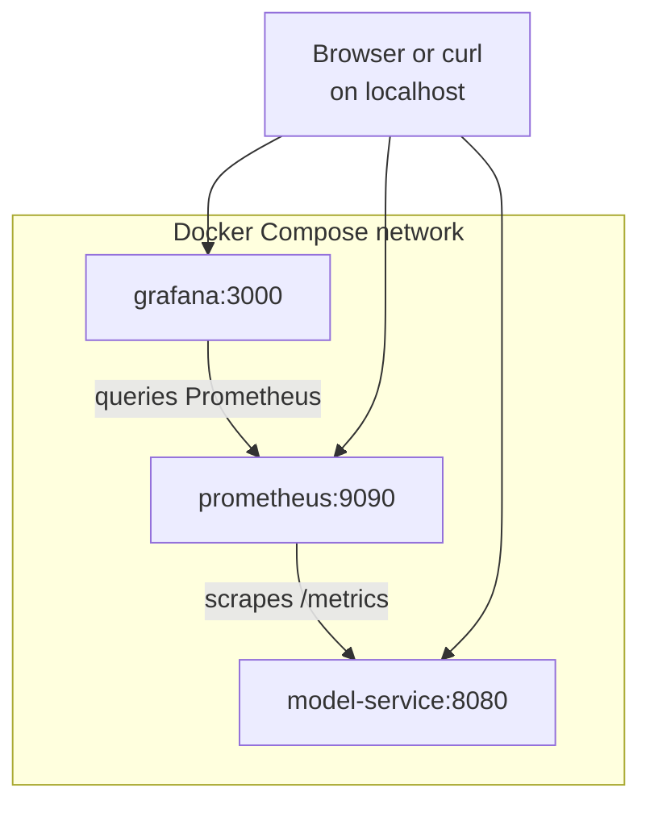

# Run the Stack with Docker Compose

Start by running everything at once: the model service, Prometheus and Grafana, together on one local Docker network. The next three lessons then open up each piece while the stack keeps running, so you can try every idea as soon as you read about it.



## Compose file

The root [docker-compose.yaml](docker-compose.yaml) defines the three services:

```yaml
services:
  model-service:
    build:
      context: .
      dockerfile: service/Dockerfile
    ports:
      - 8080:8080

  prometheus:
    image: prom/prometheus:v3.15.0
    ports:
      - 9090:9090
    volumes:
      - ./prometheus:/etc/prometheus
      - prometheus-data:/prometheus
    command: --web.enable-lifecycle --config.file=/etc/prometheus/prometheus.yaml

  grafana:
    image: grafana/grafana:13.2.3
    ports:
      - 3000:3000
    restart: unless-stopped
    environment:
      GF_ANALYTICS_CHECK_FOR_UPDATES: "false"
      GF_ANALYTICS_CHECK_FOR_PLUGIN_UPDATES: "false"
      GF_PLUGINS_PREINSTALL_DISABLED: "true"
    volumes:
      - ./grafana/provisioning:/etc/grafana/provisioning
      - ./grafana/dashboards:/etc/grafana/dashboards
      - grafana-data:/var/lib/grafana

volumes:
  prometheus-data:
  grafana-data:
```

You do not need to understand every line yet. Each service gets its own lesson:

- `model-service` is built from [service/Dockerfile](service/Dockerfile), covered in [02 - Explore the API](02-explore-the-api.md).
- `prometheus` loads its configuration from the mounted [prometheus](prometheus/) folder, covered in [03 - Set Up Prometheus](03-set-up-prometheus.md).
- `grafana` loads its data source and dashboard from the mounted [grafana](grafana/) folder, covered in [04 - Set Up Grafana](04-set-up-grafana.md).

The Prometheus and Grafana image tags are pinned so the tutorial remains reproducible.

The three environment variables on the `grafana` service disable update checks and background preinstalled-plugin downloads. These features are useful in managed Grafana installations, but they can create noisy startup logs or network-dependent behavior in a tutorial Docker stack.

## Start the services

From the repository root, run:

```bash
docker compose up --build -d
```

`--build` builds the model service image, and `-d` runs the stack in the background so your terminal stays free for the commands in the next lessons.

Check that all three containers are running:

```bash
docker compose ps
```

The model service image includes a Docker healthcheck. After a few seconds, `docker compose ps` should show the model service as `healthy`.

To follow the logs of one service, run `docker compose logs -f model-service` (or `prometheus`, `grafana`). Press `Ctrl + C` to stop following; the stack keeps running.

## Open the services

| Service | URL |
| --- | --- |
| Model service | <http://localhost:8080> |
| Prometheus | <http://localhost:9090> |
| Grafana | <http://localhost:3000> |

Grafana credentials:

- Username: `admin`
- Password: `admin`

Each page should load. The model service returns a short welcome message, Prometheus shows its query page, and Grafana asks you to log in.

## Keep the stack running

Leave the stack running for lessons 02 to 05. If you take a break, you can pause and resume it without losing data:

```bash
docker compose stop
docker compose start
```

Lesson 05 ends with a **Clean up** step that shuts everything down.

Continue with [02 - Explore the API](02-explore-the-api.md) to see what runs inside the model service.
