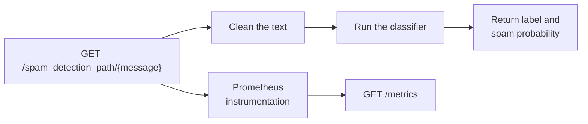

# Explore the API

The model service you started in [01 - Run the Stack](01-start-the-stack.md) is a small FastAPI app in [service/main.py](service/main.py). This lesson looks at what runs inside it and how it is packaged into the Docker image.

The app loads a pre-trained spam classifier from `service/model.bin`, exposes a prediction route, and publishes Prometheus metrics on `/metrics`.

The model artifact is tracked in this repository because the lesson starts from a pre-trained model. There is no training notebook or script here that recreates `model.bin`, so the API and Docker image need the file to be present.

## Service workflow



## Key API pieces

The app creates a FastAPI instance and attaches the Prometheus instrumentator:

```python
app = FastAPI()
Instrumentator().instrument(app).expose(app)
```

- `Instrumentator().instrument(app)` records request counts, request durations, response sizes, and related HTTP metrics.
- `expose(app)` adds the `/metrics` endpoint that Prometheus has been scraping since you started the stack. You will look at that side in [03 - Set Up Prometheus](03-set-up-prometheus.md).

The prediction route accepts the message as a path parameter:

```python
@app.get("/spam_detection_path/{message}", response_model=PredictionResponse)
async def detect_spam_path(message: str):
    return classify_message(model, message)
```

The response contains:

- `label`: the model's predicted class.
- `spam_probability`: the probability assigned to the spam class.

The service also exposes a lightweight health endpoint:

```python
@app.get("/health", response_model=HealthResponse)
def get_health():
    return HealthResponse(status="ok")
```

Health endpoints are intentionally boring. They give Docker, load balancers and operators a quick way to confirm that the API process is running before asking deeper model-specific questions.

The app uses small Pydantic response models for the root, health and prediction routes. That keeps the API contract explicit and lets FastAPI document the response schema automatically.

## Dockerfile

The Dockerfile in [service/Dockerfile](service/Dockerfile) packages the API into a reproducible container. This is the image Docker Compose built when you ran `docker compose up --build -d` in step 01:

```dockerfile
FROM ghcr.io/astral-sh/uv:0.11.19 AS uv
FROM python:3.13-slim-bookworm

WORKDIR /app

ENV PYTHONUNBUFFERED=1 \
    UV_COMPILE_BYTECODE=1 \
    UV_LINK_MODE=copy

COPY --from=uv /uv /uvx /bin/
COPY pyproject.toml uv.lock .python-version ./
RUN uv sync --locked --no-dev --no-install-project --no-cache

# Copy only the service code and the pre-trained model.
COPY service/main.py service/model.bin /app/

RUN useradd --create-home --shell /usr/sbin/nologin appuser
USER appuser

EXPOSE 8080

HEALTHCHECK --interval=30s --timeout=3s --start-period=10s --retries=3 \
  CMD python -c "from urllib.request import urlopen; urlopen('http://127.0.0.1:8080/health', timeout=2).read()" || exit 1

CMD ["uv", "run", "--no-sync", "uvicorn", "main:app", "--host", "0.0.0.0", "--port", "8080"]
```

The container listens on port `8080`. Docker Compose maps that port to your machine, so you can call the service at <http://localhost:8080>.

Three small production habits are included:

- Dependencies are installed with `uv sync --locked` from the same `uv.lock` you use locally, so the image and your editor environment cannot drift apart.
- The API runs as a non-root user after dependencies are installed.
- Python bytecode is compiled at build time for faster startup, and logs are flushed directly to the terminal.

## Dependencies

The service dependencies live in [pyproject.toml](pyproject.toml) at the repository root, and the exact resolved versions are pinned in [uv.lock](uv.lock). `scikit-learn` is kept on the same version the model in [service/model.bin](service/model.bin) was trained with.

Because the Dockerfile needs the root `pyproject.toml` and `uv.lock`, Docker Compose builds the image with the repository root as its build context. The root [.dockerignore](.dockerignore) keeps the local `.venv`, monitoring config and docs out of that context.

## Try it

Open <http://localhost:8080/docs> in your browser. FastAPI generates this interactive documentation from the routes and Pydantic response models above, so you can call each route with the **Try it out** button.

Then call the service from the terminal:

```bash
curl "http://localhost:8080/spam_detection_path/free%20prize%20now"
curl "http://localhost:8080/health"
curl "http://localhost:8080/metrics"
```

The first command exercises the model route. The health command checks the process. The metrics command shows the raw text Prometheus collects on every scrape.

## Generate traffic

Prometheus and Grafana only have something to show once the API receives requests. Use this block whenever a later lesson asks you to generate traffic:

```bash
curl "http://localhost:8080/health"
curl "http://localhost:8080/spam_detection_path/free%20prize%20now"
curl "http://localhost:8080/spam_detection_path/meeting%20at%20ten"
curl "http://localhost:8080/spam_detection_path/claim%20your%20reward"
curl "http://localhost:8080/does-not-exist"
```

The last request calls a route that does not exist, so the API answers with `404 Not Found`. It gives you one failed request to look for later.

Run it now. In the next two lessons you will find these requests again, first as raw metrics in Prometheus and then as dashboard panels in Grafana.

## Read the metrics

Call `/metrics` again and look for the lines that start with `http_request`:

```bash
curl -s "http://localhost:8080/metrics" | grep "^http_request"
```

Each line is one time series: a metric name, a set of labels in `{}` and the current value. The instrumentator publishes several metrics, and this tutorial uses two of them:

| Metric | Type | What it records |
| --- | --- | --- |
| `http_requests_total` | Counter | How many requests the service has handled since it started, split by `handler` (the route), `method`, and `status` (`2xx`, `4xx`, `5xx`). |
| `http_request_duration_seconds` | Histogram | How long requests took, split by `handler` and `method`. |

The two types behave differently:

- A **counter** only goes up. It resets to `0` only when the process restarts. Your `does-not-exist` request appears as `handler="none"` with `status="4xx"`, because the instrumentator groups unknown routes under `none`.
- A **histogram** is published as several series. `_count` is the number of requests, `_sum` is the total time they took in seconds, and `_bucket` counts how many requests finished within each time limit (`le` means "less than or equal").

Notice that `up` is not in this output. Prometheus creates `up` itself every time it scrapes a target, as you will see in the next lesson.
