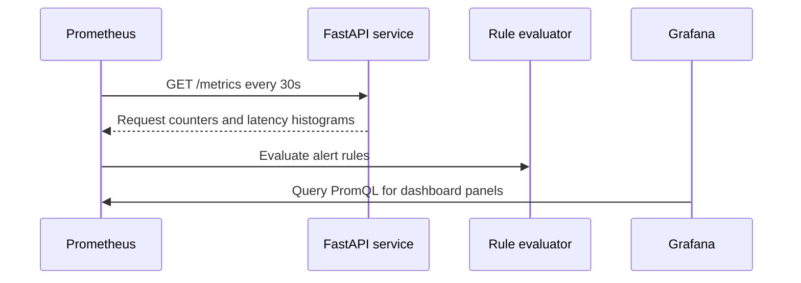

# Set Up Prometheus

Prometheus is the monitoring service in this tutorial. It repeatedly calls metrics endpoints, stores the resulting time series and evaluates alert rules against those metrics.

Prometheus has been running since you started the stack in step 01. In this repository, it scrapes two targets:

- itself, so you can see Prometheus uptime metrics,
- the FastAPI model service, so you can monitor API traffic and latency.

## What to monitor

A service can fail in different ways: it can be down, overloaded, slow, or up but returning errors. Each failure shows up in a different **signal**, so monitoring usually starts with a small set of signals that each answer one question:

| Signal | Question it answers | Metric or query in this repository |
| --- | --- | --- |
| Uptime | Can the service be reached at all? | `up`, and the `InstanceDown` alert built on it |
| Traffic | How much demand is the service handling? | `increase(http_requests_total[1m])` |
| Latency | How long do requests take? | `rate(http_request_duration_seconds_sum[5m]) / rate(http_request_duration_seconds_count[5m])` |
| Errors | How many requests fail? | `http_requests_total{status=~"4xx\|5xx"}` |

The latency query divides the total time spent on requests by the number of requests, which gives the average duration per request.

**Traffic**, **latency** and **errors** come from the metrics you read in [step 02](02-explore-the-api.md#read-the-metrics). **Uptime** sits underneath all of them: if Prometheus cannot reach the service, none of the other signals are collected.

## Scrape lifecycle



## Configuration file

The Prometheus configuration lives in [prometheus/prometheus.yaml](prometheus/prometheus.yaml):

```yaml
global:
  scrape_interval: 30s
  scrape_timeout: 10s

rule_files:
  - alert.yaml

scrape_configs:
  - job_name: services
    metrics_path: /metrics
    static_configs:
      - targets:
          - "prometheus:9090"
          - "model-service:8080"
```

The target names come from the service names in [docker-compose.yaml](docker-compose.yaml). Inside the Compose network, Prometheus can reach `model-service:8080` even though your browser reaches the same API through `localhost:8080`.

## What each section does

| Section | Role |
| --- | --- |
| `global.scrape_interval` | How often Prometheus scrapes each target. |
| `global.scrape_timeout` | How long Prometheus waits before marking a scrape as failed. |
| `rule_files` | Alert rule files to load. |
| `scrape_configs` | The list of metric endpoints Prometheus should collect from. |

## Starter alert

The alert rule in [prometheus/alert.yaml](prometheus/alert.yaml) is intentionally simple:

```yaml
groups:
  - name: service-health
    rules:
      - alert: InstanceDown
        expr: up{job="services"} < 1
        for: 5m
        labels:
          severity: warning
        annotations:
          summary: "{{ $labels.instance }} is down"
          description: "Prometheus has been unable to scrape {{ $labels.instance }} for 5 minutes."
```

The `up` metric is `1` when Prometheus successfully scrapes a target and `0` when it cannot. This alert fires when a service in the `services` job stays down for five minutes. The label and annotations make the alert easier to read in alert views and notifications.

## Try it

Open Prometheus at <http://localhost:9090> and query:

```promql
up{job="services"}
```

If you just started the stack, wait about 30 seconds before checking target health. Prometheus only updates these values after a scrape.

You should see one series for Prometheus and one for the model service, both with the value `1`.

Next, look at the request counter:

```promql
http_requests_total
```

This is a running total since the model service started, so the requests you sent in step 02 are still counted here. Each series is one combination of route, method, and status.

Counters only grow, so dashboards and alerts usually look at how much they changed recently instead. Run the [Generate traffic](02-explore-the-api.md#generate-traffic) block from step 02 again, wait about 30 seconds for the next scrape, then query:

```promql
increase(http_requests_total[1m])
```

The values for the routes you just called should go up. They drop back to `0` about a minute after you stop sending requests, because the query only looks at the last minute.

`increase(...[1m])` answers "how much did the counter grow in the last minute?". The related `rate(...[1m])` answers the same question per second, which is why the latency query uses `rate`: dividing one per-second rate by another cancels the time unit out.

Now look for the failed request you sent:

```promql
http_requests_total{status=~"4xx|5xx"}
```

`=~` matches the label against a regular expression, so this query keeps only the series with client (`4xx`) or server (`5xx`) errors. You should see your `does-not-exist` request under `handler="none"`.

The HTTP metrics come from the FastAPI instrumentation layer. They answer service questions such as "is the API receiving traffic?" and "are requests slow?". They do not answer model-quality questions such as "is spam recall dropping?" without additional custom model metrics.

## Test the alert

To test the `InstanceDown` alert, stop only the model service:

```bash
docker compose stop model-service
```

After the next scrape, `up{job="services"}` shows `0` for `model-service:8080`. Open **Alerts** in Prometheus to follow `InstanceDown`:

- **Pending**: the condition is true, but has not lasted five minutes yet.
- **Firing**: the service has been down for the full `for: 5m` window.

Start the service again with:

```bash
docker compose start model-service
```

Then confirm the health endpoint responds again:

```bash
curl "http://localhost:8080/health"
```

> **Note:** Prometheus evaluates alert rules once a minute by default, so `InstanceDown` can stay `firing` for up to a minute after the service is back.

Restarting the model service also restarts its Python process, so `http_requests_total` starts counting from `0` again.
