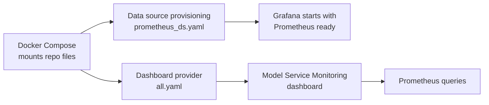
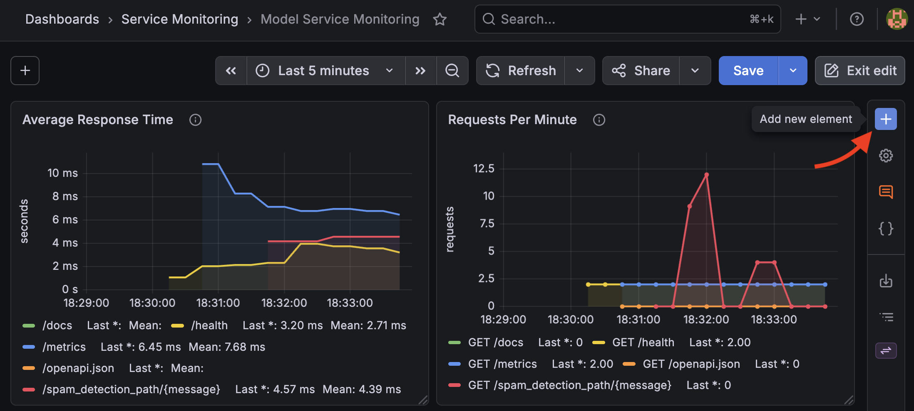

# Set Up Grafana

Grafana is the dashboard layer for this tutorial. Prometheus stores the metrics; Grafana makes them easier to inspect, compare, and share.

Grafana in this stack starts preconfigured. Open <http://localhost:3000> and look around:

- **Connections** → **Data sources** lists a `Prometheus` data source.
- **Dashboards** shows a `Service Monitoring` folder with the `Model Service Monitoring` dashboard.

That is because the repository provisions Grafana from files, so you start with a working dashboard instead of clicking through a long manual setup. This lesson shows the files that do that.

## Dashboard provisioning flow



Provisioning means the dashboard is reproducible: if you restart the stack or clone the repo on another machine, Grafana reads the same configuration files again.

## Provision the Prometheus data source

The data source configuration lives in [grafana/provisioning/datasources/prometheus_ds.yaml](grafana/provisioning/datasources/prometheus_ds.yaml):

```yaml
apiVersion: 1

datasources:
  - name: Prometheus
    uid: prometheus
    type: prometheus
    access: proxy
    url: http://prometheus:9090
    isDefault: true
    editable: true
```

Important fields:

| Field | Meaning |
| --- | --- |
| `name` | The display name Grafana uses for the data source. |
| `uid` | The stable ID dashboard panels use to refer to this data source. |
| `access: proxy` | Grafana queries Prometheus from inside the Docker network. |
| `type: prometheus` | Tells Grafana which query engine and UI to use. |
| `url` | The Prometheus service URL inside Docker Compose. |
| `isDefault` | Makes this data source the default for dashboard panels. |

## Provision the dashboard folder

The dashboard provider configuration lives in [grafana/provisioning/dashboards/all.yaml](grafana/provisioning/dashboards/all.yaml):

```yaml
apiVersion: 1

providers:
  - name: service-monitoring
    orgId: 1
    folder: Service Monitoring
    type: file
    disableDeletion: false
    allowUiUpdates: true
    options:
      path: /etc/grafana/dashboards
```

This tells Grafana to load dashboard JSON files from `/etc/grafana/dashboards`, which Docker Compose maps to the repo's [grafana/dashboards](grafana/dashboards) directory.

`allowUiUpdates: true` lets you save changes to this provisioned dashboard in the Grafana UI during the exercise below.

The empty `grafana/provisioning/alerting` and `grafana/provisioning/plugins` directories are kept in the repo with placeholder files. Grafana checks those paths on startup, even when this tutorial does not provision alert rules or plugins through Grafana.

## Starter dashboard

The starter dashboard is [grafana/dashboards/service-dashboard.json](grafana/dashboards/service-dashboard.json). It includes three panels:

| Panel | Query | What it shows |
| --- | --- | --- |
| Average Response Time | `sum by (handler) (rate(http_request_duration_seconds_sum[5m])) / sum by (handler) (rate(http_request_duration_seconds_count[5m]))` | Average request duration by route over the last five minutes. |
| Requests Per Minute | `sum by (method, handler) (increase(http_requests_total[1m]))` | How request volume changes as you call the API. |
| Scrape Target Health | `up{job="services"}` | Whether Prometheus can currently scrape each target. |

Inside Grafana go to **Dashboards**. The starter dashboard appears as `Model Service Monitoring` in the `Service Monitoring` folder.

The panels only show data for recent traffic, and the alert test in step 03 restarted the model service. `rate` and `increase` need at least two scrape samples. Send an initial prediction and wait for a scrape before the burst, so Prometheus can compare the counters before and after it:

```bash
curl -s "http://localhost:8080/spam_detection_path/free%20prize%20now" > /dev/null
sleep 35

for i in {1..10}; do
  curl -s "http://localhost:8080/spam_detection_path/free%20prize%20now" > /dev/null
  curl -s "http://localhost:8080/spam_detection_path/meeting%20at%20ten" > /dev/null
done
```

Wait about 30 seconds for the next scrape, then refresh the dashboard and watch the request-count and response-time panels.

## Add a panel manually

You can also add a panel from the Grafana UI. Click on **Edit**, then on the **+** symbol.



Use the existing provisioned dashboard as a reference: create a new panel, choose the `Prometheus` data source, paste one of the queries below, and give the panel a title that states the operational question it answers.

Save the dashboard when you finish. UI changes are stored in the local Grafana volume, not written back to the repository JSON. To version them in Git, export the dashboard as Classic JSON and update [grafana/dashboards/service-dashboard.json](grafana/dashboards/service-dashboard.json). Updating that provisioning file can overwrite UI changes; see the [Grafana provisioning guide](https://grafana.com/docs/grafana/latest/administration/provisioning/#make-changes-to-a-provisioned-dashboard).

Useful starter PromQL queries:

```promql
up{job="services"}
```

```promql
increase(http_requests_total[1m])
```

```promql
rate(http_request_duration_seconds_sum[5m])
/
rate(http_request_duration_seconds_count[5m])
```

## Inspect alerts in Grafana

Grafana can also show the alert rules Prometheus evaluates. Open **Alerting** → **Alert rules** and look for `InstanceDown` under the Prometheus data source. If you triggered the alert in step 03, its state here matches what you saw on the Prometheus **Alerts** page.

## Summary

You have run a model service, explored its metrics endpoint, scraped it with Prometheus, and visualized it with Grafana. This is the foundation for production monitoring: first make the service observable, then turn the most important signals into dashboards and alerts.

The important habit is to connect each dashboard panel or alert to a question about the service:

- Is the API up?
- Is traffic reaching the service?
- Are requests becoming slower?
- Did the service stop responding long enough to page someone?

Continue with [05 - Observability Experiments](05-observability-experiments.md) to practice reading those signals during traffic and failure scenarios.
