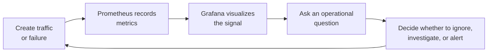
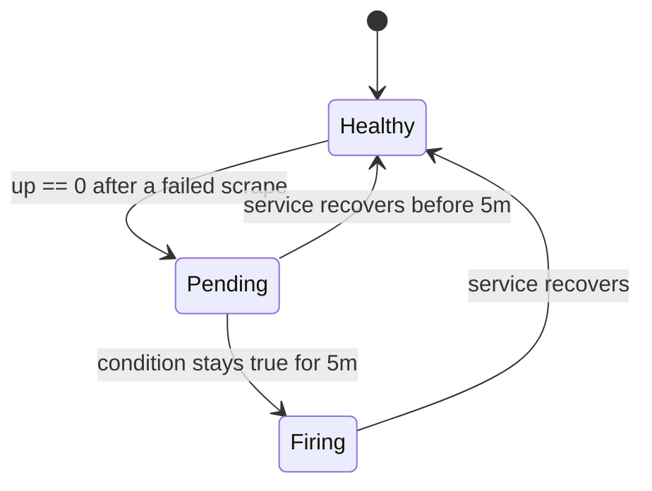

# Observability Experiments

This final step turns the monitoring stack into a small investigation lab. The goal is to connect what you do to the service with what you see in Prometheus and Grafana.

The stack should still be running from step 01. If it is not, start it again from the repository root:

```bash
docker compose up --build -d
```

Open these pages in a browser if they are not already open:

| Tool | URL | What to watch |
| --- | --- | --- |
| Model service | <http://localhost:8080> | API responses |
| Prometheus | <http://localhost:9090> | Raw metric queries and alert state |
| Grafana | <http://localhost:3000> | Dashboard panels |

Grafana credentials are `admin` / `admin`.

## Investigation Loop

Observability is a loop: create a signal, inspect it, explain it, then decide what action would make sense.



Use this loop for each experiment below.

## Experiment notes template

For each experiment, capture a short note with:

| Field | What to write |
| --- | --- |
| Action | The command or UI action you ran. |
| Expected signal | The metric, panel or alert state you expected to change. |
| Observed signal | What Prometheus or Grafana actually showed after one scrape interval. |
| Interpretation | Whether the signal answers an uptime, traffic, latency, errors, or alerting question. |

These notes help you turn each command into an operational observation.

## Experiment 1: Baseline health

Start with a quiet service and confirm that all targets are up.

```bash
curl "http://localhost:8080/health"
curl "http://localhost:9090/api/v1/query?query=up%7Bjob%3D%22services%22%7D"
```

Expected result:

- `model-service:8080` should have `up = 1`.
- `prometheus:9090` should have `up = 1`.
- The Grafana `Scrape Target Health` panel should show healthy targets.

> **Why this matters:** Before interpreting request volume or latency, first check that Prometheus can actually scrape the services.

## Experiment 2: Generate prediction traffic

Send a few prediction requests to create request-count and latency signals, plus one request to a route that does not exist to create an error signal.

```bash
curl "http://localhost:8080/spam_detection_path/free%20prize%20now"
curl "http://localhost:8080/spam_detection_path/meeting%20at%20ten"
curl "http://localhost:8080/spam_detection_path/claim%20your%20reward"
curl "http://localhost:8080/spam_detection_path/can%20we%20reschedule"
curl "http://localhost:8080/does-not-exist"
```

Then query Prometheus directly:

```bash
curl "http://localhost:9090/api/v1/query?query=sum%20by%20%28handler%29%20%28increase%28http_requests_total%5B5m%5D%29%29"
```

In Grafana, inspect:

- `Average Response Time`
- `Requests Per Minute`

Interpretation questions:

- Which route received traffic?
- Did the prediction route appear separately from `/health`?
- Is the response time stable after several calls?
- Which `status` label does the failed request have, and which panel on the dashboard shows it? If none does, what panel would you add?

## Experiment 3: Create a small traffic burst

Use a loop to send repeated requests. This makes the dashboard easier to read than isolated calls.

```bash
for i in {1..30}; do
  curl -s "http://localhost:8080/spam_detection_path/free%20prize%20now" > /dev/null
  curl -s "http://localhost:8080/health" > /dev/null
done
```

Wait one scrape interval, then refresh Grafana:

```bash
sleep 35
```

What to look for:

- Request volume should increase.
- `/health` and the prediction route may show different counts.
- Average response time should remain low for this small local workload.

This is a service-level experiment. It tells you whether the API is responding and how quickly it responds. It does not tell you whether the classifier is accurate.

## Experiment 4: Simulate a service failure

Stop only the model service:

```bash
docker compose stop model-service
```

After one scrape interval, query Prometheus:

```bash
sleep 35
curl "http://localhost:9090/api/v1/query?query=up%7Binstance%3D%22model-service%3A8080%22%7D"
```

Expected result:

- `up` for `model-service:8080` should become `0`.
- The Grafana health panel should show the failed target.
- The `InstanceDown` alert should become pending before it can become firing.

The alert rule uses `for: 5m`, so it waits five minutes before firing. This avoids alerting for very short restarts.



Restart the service:

```bash
docker compose start model-service
```

Then confirm recovery. Prometheus evaluates alert rules once a minute by default, so `InstanceDown` can stay `firing` for up to a minute after the service is back:

```bash
sleep 35
curl "http://localhost:8080/health"
curl "http://localhost:9090/api/v1/query?query=up%7Binstance%3D%22model-service%3A8080%22%7D"
```

## Experiment 5: Add one useful query

Open Prometheus and try this query:

```promql
sum by (method, handler) (increase(http_requests_total[5m]))
```

Then try the latency query used by the dashboard:

```promql
sum by (handler) (rate(http_request_duration_seconds_sum[5m]))
/
sum by (handler) (rate(http_request_duration_seconds_count[5m]))
```

What each query answers:

| Query | Question |
| --- | --- |
| `up{job="services"}` | Can Prometheus scrape each target? |
| `increase(http_requests_total[5m])` | How many requests arrived recently? |
| Average duration query | How long did requests take on average? |

## Reflection

Write short answers to these questions:

1. Which metric would you check first if users report that the API is unavailable?
2. Which metric would you check first if users report that the API is slow?
3. Why does the `InstanceDown` alert wait five minutes before firing?
4. What extra signal would you add before calling this production-ready?

Good monitoring starts with a clear question. The dashboard is useful only when each panel helps answer a question about the service.

## Clean up

Stop the stack when you are done experimenting:

```bash
docker compose down
```

Add `-v` if you also want to remove the Prometheus and Grafana volumes and return to an empty monitoring state:

```bash
docker compose down -v
```
