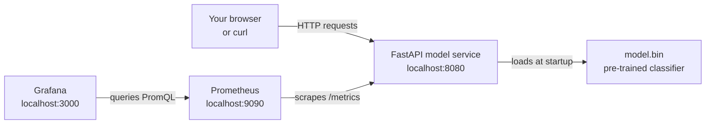

# Service Monitoring and Alerting

This repository shows how to monitor a small Machine Learning service after it has been deployed. You run a FastAPI spam classification API together with Prometheus and Grafana, read the metrics the API exposes, query them with PromQL, visualize them in a dashboard, and test a basic alert.

The goal is to understand the operational layer around a served model: uptime, traffic, latency, errors, dashboards, and alerts.

## Learning Objectives

By the end of this repository, you should be able to:

- Serve a pre-trained text classification model with FastAPI.
- Expose request and latency metrics for Prometheus.
- Configure Prometheus scrape targets and a starter alert rule.
- Provision a Grafana data source and dashboard from files.
- Run small observability experiments and explain what uptime, request-count, and response-time signals mean.
- Explain the difference between service-level metrics and model-quality metrics.

## Learning Path

| File / Folder | Description |
|---|---|
| [**01 - Run the Stack**](01-start-the-stack.md) | Start the model service, Prometheus, and Grafana together. |
| [**02 - Explore the API**](02-explore-the-api.md) | Inspect the FastAPI service, its routes, Dockerfile and Prometheus instrumentation, then send your first requests and read the metrics they produce. |
| [**03 - Set Up Prometheus**](03-set-up-prometheus.md) | Learn the uptime, traffic, latency and errors signals, read the scrape configuration and `InstanceDown` alert, query metrics, and test the alert. |
| [**04 - Set Up Grafana**](04-set-up-grafana.md) | See how the data source and dashboard are provisioned from files, then add a panel of your own. |
| [**05 - Observability Experiments**](05-observability-experiments.md) | Connect traffic, failures, PromQL queries, dashboards and alert behavior through small experiments. |

### Additional Folders and Files

| File / Folder | Description |
|---|---|
| [**main.py**](service/main.py) | FastAPI spam classification service with health and metrics endpoints. |
| [**model.bin**](service/model.bin) | Pre-trained spam classification model loaded by the API at startup. |
| [**Dockerfile**](service/Dockerfile) | Container image for the model service, installed from `uv.lock`. |
| [**docker-compose.yaml**](docker-compose.yaml) | Local stack with the model service, Prometheus and Grafana. |
| [**prometheus.yaml**](prometheus/prometheus.yaml) | Prometheus scrape configuration. |
| [**alert.yaml**](prometheus/alert.yaml) | Starter `InstanceDown` alert rule. |
| [**grafana/provisioning**](grafana/provisioning/) | Data source and dashboard provisioning files for Grafana. |
| [**service-dashboard.json**](grafana/dashboards/service-dashboard.json) | Provisioned Grafana dashboard for the model service. |
| [**assets**](assets/) | Visual aids referenced in the repository. |
| [**pyproject.toml**](pyproject.toml) | Project configuration and dependencies. |
| [**uv.lock**](uv.lock) | Dependency lock file. |

## Architecture



The lesson focuses on service observability. Prometheus and Grafana can show whether the API is reachable, receiving traffic, responding quickly, and returning errors. They do not measure classifier quality unless you add model-specific metrics later.

## Local Stack

The Docker Compose stack exposes three local services:

| Service | URL | Purpose |
| --- | --- | --- |
| Model service | <http://localhost:8080> | Serves predictions and `/metrics`. |
| Prometheus | <http://localhost:9090> | Scrapes metrics and evaluates alerts. |
| Grafana | <http://localhost:3000> | Visualizes metrics in a dashboard. |

## Prerequisites

- **Docker Desktop**: required to run the model service, Prometheus, and Grafana. Follow the [installation instructions](https://docs.docker.com/get-docker/) if you do not have it yet. Make sure it is **installed and running** before you start the walkthrough.

> [!NOTE]
> **Windows Users:** The commands in this walkthrough use bash syntax. Use **Git Bash** (installed with [Git for Windows](https://git-scm.com/downloads/win)) instead of PowerShell to run them.

## Setup

> [!NOTE]
> Throughout these steps, text in angle brackets like `<repo-name>` is a **placeholder**. Replace it, including the `< >` brackets, with your own value. For example, `cd <repo-name>` becomes `cd mle-service-monitoring-and-alerting`.

### 1. Use This Repository as a Template

Click **Use this template** on GitHub.

When creating the repository:

- Set yourself as the **Owner**
- Choose a repository name
- Disable **Include all branches**
- Click **Create repository**

> [!IMPORTANT]
> If you are working in pairs or groups, only **one person** should complete this step.

---

### 2. Add Collaborators (Pairs/Groups Only)

If working with teammates:

1. Open the repository on GitHub
2. Go to **Settings → Collaborators**
3. Add your teammates as collaborators
4. Share the repository link with your team

Teammates should accept the invitation before continuing.

---

### 3. Clone Your Copy

Copy the SSH URL from the **Code** button on GitHub, then run:

```bash
git clone <copied-ssh-url>
```

The copied SSH URL will look like `git@github.com:<your-username>/<repo-name>.git`.

---

### 4. Move into the Project Folder and Install Dependencies

This installs all dependencies and creates a virtual environment in `.venv/`.

```bash
cd <repo-name>
uv sync
```

> [!NOTE]
> The services themselves run in Docker Compose (step 01). The Docker image installs the same dependencies from `uv.lock`, so the local environment only gives your editor the same packages the container uses.

---

### 5. Open the Repository in VS Code

> [!NOTE]
> Make sure you open VS Code from the project root so it automatically detects the environment created by `uv sync`.

Launch VS Code in the project root folder:

```bash
code .
```

When you open [service/main.py](service/main.py), select the Python environment created by `uv sync` as the interpreter so imports and autocompletion resolve correctly.

## References & Further Reading

- [Prometheus Overview](https://prometheus.io/docs/introduction/overview/): What Prometheus is, its data model, and when to use it.
- [Prometheus Alerting Rules](https://prometheus.io/docs/prometheus/latest/configuration/alerting_rules/): How `expr`, `for`, labels, and annotations work in alert rules like `alert.yaml`.
- [Prometheus FastAPI Instrumentator](https://github.com/trallnag/prometheus-fastapi-instrumentator): The library that exposes `/metrics` in the model service.
- [Grafana Provisioning](https://grafana.com/docs/grafana/latest/administration/provisioning/): How Grafana loads data sources and dashboards from version-controlled files.
- [Google SRE Book: Monitoring Distributed Systems](https://sre.google/sre-book/monitoring-distributed-systems/): The four golden signals (latency, traffic, errors, saturation) as used by production teams at Google.
